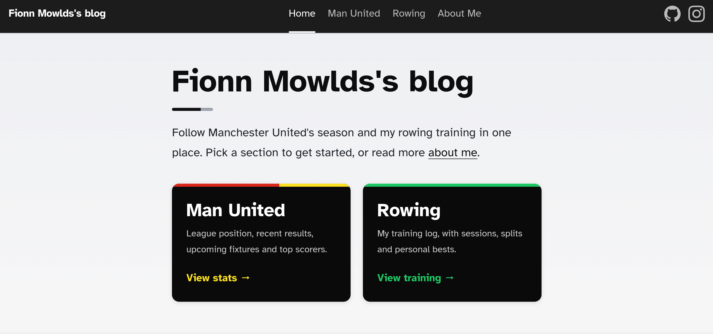
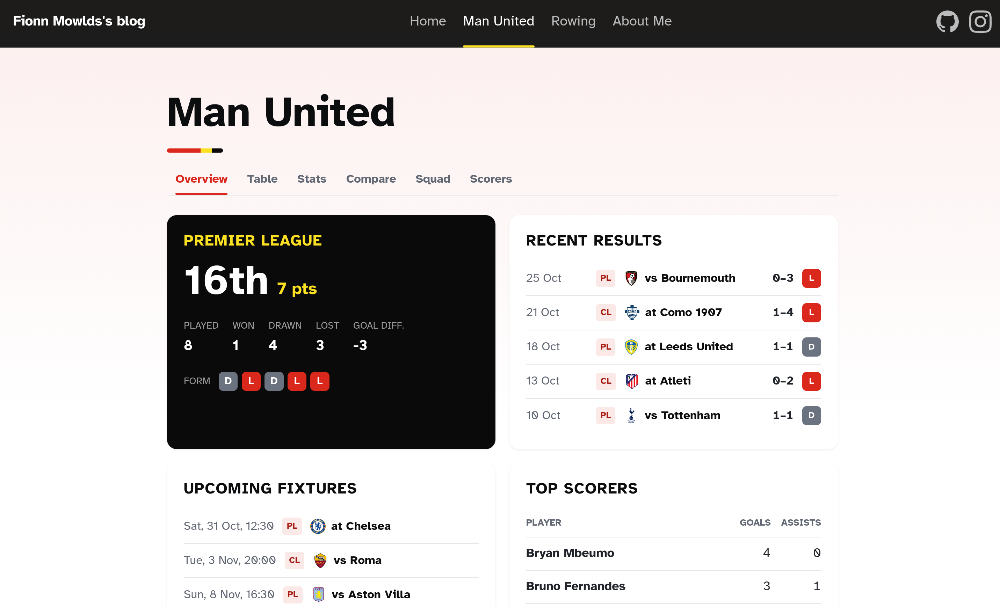
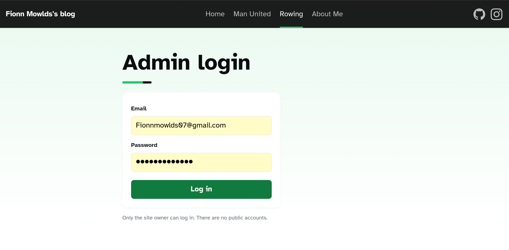
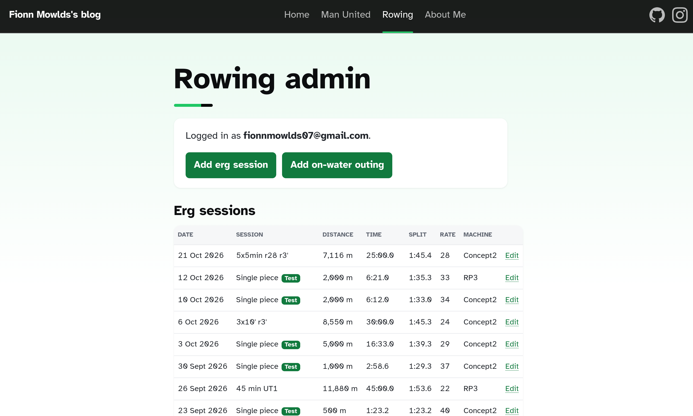
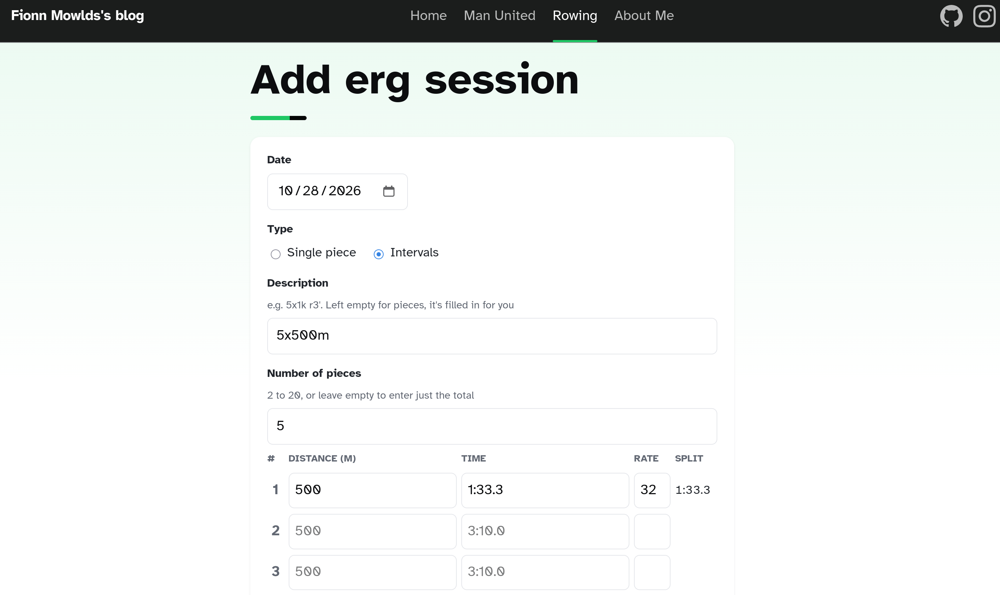
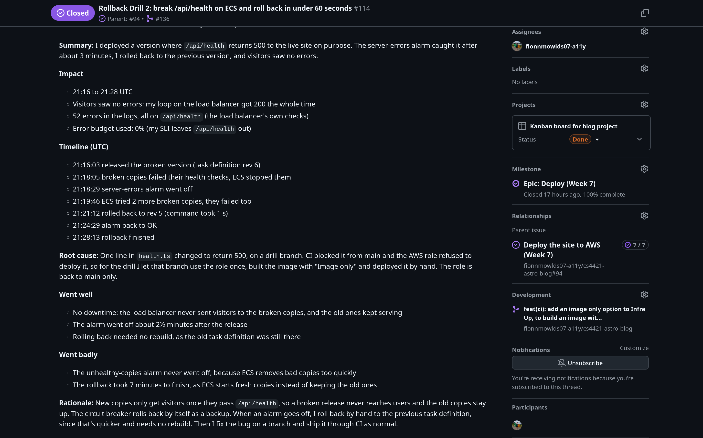

# Fionn Mowlds' Blog

My personal site for CS4421 DevOps at the University of Limerick. It started as the Astro blog
starter and grew into a server-rendered site with live football stats and a log of my rowing
training, tested in CI and deployed to AWS.

- **Site:** https://blog.fionnmowlds.website (the SSR site only runs during a session, see below)
- **Static version (v1.0.0):** https://static.fionnmowlds.website
- **Board:** [Kanban board](https://github.com/users/fionnmowlds07-a11y/projects/2)

## What's on the site

| Section    | What it does                                                                                                   |
| ---------- | -------------------------------------------------------------------------------------------------------------- |
| About Me   | Blog posts from Markdown content collections, plus an RSS feed                                                  |
| Man United | Table, stats, squad, scorers and a team comparison from football-data.org, cached so the site copes with its limits |
| Rowing     | My PBs and recent sessions. Only my account can log in and add or edit sessions (Supabase with row level security) |
| API        | `/api/health` for the load balancer (`?deep=1` also checks the database), `/api/feedback`, football summaries    |

## Screenshots of live site for ease of marking

The home page, linking to the Man United and Rowing sections.



The Man United overview with league position, recent results, fixtures and top scorers.



The admin login for the rowing pages, which only my account can use.



The rowing admin page where I add and edit my erg sessions and on-water outings.



Adding an erg session as admin, with the split worked out for each piece.



The write-up of the rollback drill in issue [#114](https://github.com/fionnmowlds07-a11y/cs4421-astro-blog/issues/114).



## How it's built

- **Astro 7** with `output: 'server'` on Node 24. Content pages are prerendered, the APIs,
  football pages and rowing admin are rendered on the server.
- **Supabase** (Postgres) for the rowing log, with migrations, row level security and pgTAP
  tests in `supabase/`.
- **Docker** image (`Dockerfile`, `docker-compose.yml`) with a health check.
- **AWS CDK** in `cdk/`: ECS Fargate with 2 copies behind a load balancer, a deployment
  circuit breaker, CloudFront, Route 53 and HTTPS, secrets in Parameter Store, JSON logs and
  alarms in CloudWatch.

## Run it locally

You need Node 22.12 or newer and Docker (for the local database).

```sh
npm install
cp .env.example .env   # add your football-data.org key; Supabase values come from the next step
npm run db:start       # local Supabase; copy API_URL and PUBLISHABLE_KEY from npm run db:status
npm run admin:create   # optional: a local admin login for the rowing pages
npm run dev            # http://localhost:4321
```

The site still works without the keys: the football and rowing pages show a friendly message
instead.

## Tests

| Command             | What it checks                                                          |
| ------------------- | ----------------------------------------------------------------------- |
| `npm run lint`      | ESLint                                                                  |
| `npm run test:unit` | Vitest unit tests (football data, rowing forms, login guard)            |
| `npm run test:bdd`  | Cucumber scenarios in `features/` against a running server              |
| `npm run test:e2e`  | Playwright in a real browser (`e2e/`)                                    |
| `npx supabase test db` | pgTAP tests for the database tables and security                    |
| `cd cdk && npm test`   | Jest tests for the AWS infrastructure                                |

## CI/CD

| Workflow          | When                  | What it does                                                                                  |
| ----------------- | --------------------- | --------------------------------------------------------------------------------------------- |
| `ci.yml`          | Every PR and push to main | Lint, unit tests, Docker build, BDD and Playwright against the container, database tests, CDK tests |
| `infra-up.yml`    | By hand               | Builds the image, pushes it to ECR and deploys the SSR stack, then checks `/api/health`. "Image only" just builds and pushes |
| `infra-down.yml`  | By hand               | Deletes the SSR stack and images so nothing costs money between sessions                      |
| `deploy-static.yml` | By hand             | Deploys a static release (v1.x) to S3 and CloudFront                                           |

`main` is protected: changes go through a PR and all CI checks must pass. GitHub logs in to AWS
with OIDC, so no AWS keys are stored in the repo, and the role only trusts runs on `main`.


## Docs

- [ADR-001](docs/adr/ADR-001-transition-to-ssr-and-containers.md): moving from a static site to SSR in containers
- [ADR-002](docs/adr/ADR-002-own-supabase-project-for-rowing-data.md): a separate Supabase project for the rowing data
- [ADR-003](docs/adr/ADR-003-run-the-site-on-ecs-fargate-per-session.md): ECS Fargate, created and deleted per session

